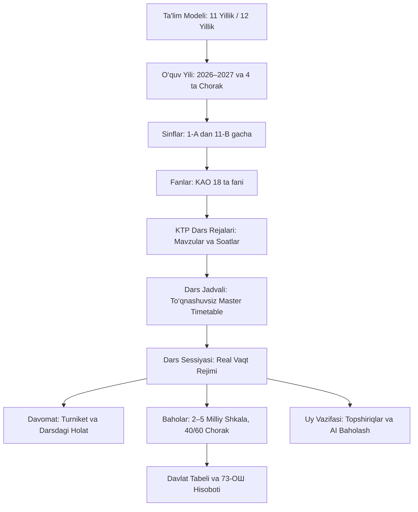

# EduSphere Pro — KAO Akademik Dvigatel Xaritasi (KAO_ACADEMIC_MAPPING.md)

**Versiya:** 3.0.0-PROD  
**Sana:** 2026-09-05  

---

## 1. Kanonik ERP Akademik Zanjiri

---

## 2. KAO Qirg‘iziston Ta'lim Standartlari Taqsimoti

1. **11 Yillik Model (БУП №973, 2026–2027):**
   - 1-sinf: 22 soat/hafta
   - 7-sinf: 32 soat/hafta
   - 11-sinf: 34 soat/hafta
2. **12 Yillik Model (БУП №969/1, 2026–2027):**
   - Kengaytirilgan STEAM va modulli kasbiy ta'lim bloklari.
3. **Maxsus Majburiy Fanlar:**
   - «Диндердин өнүгүү тарыхы» (7–9-sinflar, 1s/hafta) — Buyruq №393.
   - «Аскерге чакырууга чейинки даярдоо (АЧД / ДПМ)» (10–11-sinflar, 1s/hafta) — Buyruq №124.

---

## 3. Baholash va Hisob-Kitob Formulasi

- **Choraklik Baholash:**
  $$\text{Chorak} = (\text{Formativ O‘rtacha} \times 0.40) + (\text{Summativ O‘rtacha} \times 0.60)$$
- **Yillik Baholash:**
  $$\text{Yillik} = \frac{\text{Q1} + \text{Q2} + \text{Q3} + \text{Q4} + (2 \times \text{Imtihon})}{4 + (2 \text{ agar mavjud bo‘lsa})}$$
- **Davlat Tabeli va 73-ОШ:** To‘liq avtomatlashtirilgan.

